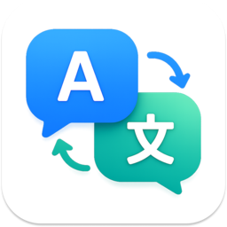

<div align="center">



# 气泡翻译

### Bubble Translate

轻量、可配置的桌面截图与划词翻译工具<br>
A lightweight and configurable desktop translator for screenshots and selected text


[中文](#中文说明) · [English](#english) · [架构文档](docs/ARCHITECTURE.md)

</div>

---

## 中文说明

气泡翻译是一款常驻系统托盘的桌面翻译工具。它可以快速截取屏幕区域、翻译选中的文字，也可以作为一个随时可用的手动翻译输入框。

项目支持本地或远程 OpenAI 兼容模型，并内置 DeepL、百度翻译、有道翻译和 Google 免费翻译适配。OCR 模型和翻译模型可以使用完全独立的服务地址与密钥。

### 功能亮点

| 功能 | 说明 |
| --- | --- |
| 截图翻译 | 使用 `Alt + Z` 框选屏幕区域并翻译 |
| 自动划词提示 | 拖选文本后在选区旁显示翻译按钮 |
| 划词翻译 | 使用 `Ctrl + Q` 翻译当前选中的文本 |
| 手动翻译 | 未检测到选中文本时自动打开编辑气泡 |
| 双阶段识别 | 支持专用 OCR 识别后翻译 |
| VLM 识别 | 支持视觉语言模型识别截图后翻译 |
| 多翻译引擎 | LLM、DeepL、百度、有道、Google 免费翻译 |
| 独立 API | OCR 与翻译模型可配置不同地址、密钥和模型 |
| 智能气泡 | 自适应高度、原文编辑、复制；左键选择语言，右键交换原文与目标语言（需选定具体原文语言） |
| 精简模式 | 可隐藏顶部气泡菜单，只显示译文 |
| 气泡默认位置 | 右上角、左上角、顶部居中可选，默认顶部居中 |
| 独立语言偏好 | 每种翻译引擎分别保存原文和目标语言 |

### 工作方式

#### 截图翻译

```text
Alt + Z
   ↓
框选屏幕区域
   ↓
OCR 专用模型 / VLM 识别原文
   ↓
当前翻译引擎生成译文
   ↓
气泡展示结果
```

#### 划词翻译

```text
选中文字
   ↓
选区旁显示翻译按钮，点击按钮
或直接按 Ctrl + Q
   ↓
读取剪贴板并立即恢复原内容
   ↓
翻译并显示气泡
```

### 支持的翻译服务

| 引擎 | 凭据 | 说明 |
| --- | --- | --- |
| OpenAI 兼容 LLM | API URL、API Key | 支持本地或远程 Chat/VLM 服务 |
| DeepL | API Key、API URL | 支持自定义 Free/Pro 接口地址 |
| 百度翻译 | App ID、密钥 | 使用官方通用翻译 API |
| 有道翻译 | 应用 ID、应用密钥 | 使用官方文本翻译 API |
| Google 免费翻译 | 无 | 使用免密端点，稳定性取决于网络与上游服务 |

### 快速开始

#### 环境要求

- Python 3.10 或更高版本
- Windows 10/11 或 macOS

#### 安装

```bash
git clone <your-repository-url>
cd BubbleTranslate

python -m venv venv
```

Windows:

```powershell
.\venv\Scripts\Activate.ps1
pip install -r requirements.txt
```

macOS:

```bash
source venv/bin/activate
pip install -r requirements.txt
```

#### 运行

```bash
python -m src.main
```

启动后，右键单击系统托盘中的气泡翻译图标即可打开设置。

### 快捷键

| 操作 | Windows | macOS |
| --- | --- | --- |
| 截图翻译 | `Alt + Z` | `Control + Option + Z` |
| 划词/手动翻译 | `Ctrl + Q` | `Control + Q` |
| 退出截图模式 | 双击右键或 `Esc` | 双击右键或 `Esc` |

### 配置

设置窗口分为四个页面：

- **设置**：翻译引擎、截图策略、语言、自动划词提示、开机启动。
- **气泡**：顶部菜单、透明度、边框颜色、字体大小、气泡宽度。
- **模型**：翻译模型与 OCR 模型。
- **API**：LLM、OCR、DeepL、百度和有道服务配置。

开发环境配置保存在项目根目录的 `config.ini`。打包版本配置保存在：

- Windows：`%APPDATA%\BubbleTranslate\config.ini`
- macOS：应用用户数据目录

`config.ini` 已加入 `.gitignore`，请勿提交真实密钥。

### 测试

```bash
python -m unittest discover -s tests -v
```

测试覆盖 OpenAI 普通及流式响应、OCR 路由、翻译服务签名、设置保存、气泡状态和右键事件拦截。

### 打包

Windows:

```bash
pyinstaller BubbleTranslate.spec
```

生成安装程序前，使用 Inno Setup 编译：

```text
installer.iss
```

macOS:

```bash
pyinstaller MacBubbleTranslate.spec
```

### 项目结构

```text
BubbleTranslate/
├── assets/icons/              # 气泡界面图标
├── docs/ARCHITECTURE.md       # 架构说明
├── scripts/                   # 开发调试工具
├── src/
│   ├── core/
│   │   ├── llm_engine.py      # 后台翻译任务与流程编排
│   │   ├── openai_client.py   # OpenAI 兼容客户端
│   │   └── translation_services.py
│   ├── ui/
│   │   ├── bubble.py          # 翻译气泡
│   │   ├── config_gui.py      # 托盘设置窗口
│   │   └── overlay.py         # 截图选区
│   ├── config.py              # 配置读写
│   ├── main.py                # 应用入口
│   └── resources.py           # 资源路径
├── tests/                     # 自动化回归测试
├── BubbleTranslate.spec       # Windows 打包配置
├── MacBubbleTranslate.spec    # macOS 打包配置
└── installer.iss              # Windows 安装器
```

### 隐私与安全

- 使用本地 OpenAI 兼容服务时，文本与截图可以完全留在本机网络中。
- 使用第三方翻译服务时，待翻译内容会发送给对应服务商。
- 源码不包含默认 API 密钥。
- 截图只处理用户框选的区域。

### 贡献

欢迎提交 Issue 和 Pull Request。提交代码前请运行：

```bash
python -m unittest discover -s tests -v
```

建议每个 Pull Request 聚焦一个主题，并为新增行为补充测试。

### 开源许可证

项目尚未添加正式开源许可证。公开发布前请根据发布计划选择并加入合适的 `LICENSE` 文件。

---

## English

Bubble Translate is a system-tray desktop translator for screenshots, selected text, and manual input.

It supports local or remote OpenAI-compatible models as well as DeepL, Baidu Translate, Youdao Translate, and a built-in keyless Google Translate endpoint. OCR and translation models can use separate API endpoints, credentials, and model names.

### Highlights

| Feature | Description |
| --- | --- |
| Screenshot translation | Press `Alt + Z` and select any screen region |
| Automatic selection tip | Shows a translate button next to dragged text |
| Selected-text translation | Press `Ctrl + Q` to translate selected text |
| Manual input | Opens the editor when no selected text is detected |
| OCR pipeline | Recognize text with a dedicated OCR model before translation |
| VLM pipeline | Recognize screenshots with a vision-language model |
| Multiple providers | LLM, DeepL, Baidu, Youdao, and Google |
| Separate APIs | Independent OCR and translation endpoints and credentials |
| Smart bubble | Adaptive height, editable source, copy; left-click to select languages, right-click to swap them (requires a specific source language) |
| Minimal mode | Hide the toolbar and display translation only |
| Provider preferences | Independent source and target languages per provider |
| Default bubble position | Choose top right, top left, or top center; defaults to top center |

### Translation Providers

| Provider | Credentials | Notes |
| --- | --- | --- |
| OpenAI-compatible LLM | API URL and API key | Local or remote Chat/VLM services |
| DeepL | API key and API URL | Custom Free or Pro endpoint |
| Baidu Translate | App ID and secret | Official general translation API |
| Youdao Translate | App ID and app secret | Official text translation API |
| Google Translate | None | Keyless endpoint; availability depends on the upstream service |

### Quick Start

Requirements:

- Python 3.10+
- Windows 10/11 or macOS

Install and run:

```bash
git clone <your-repository-url>
cd BubbleTranslate

python -m venv venv
pip install -r requirements.txt
python -m src.main
```

On Windows PowerShell, activate the virtual environment with:

```powershell
.\venv\Scripts\Activate.ps1
```

On macOS:

```bash
source venv/bin/activate
```

### Keyboard Shortcuts

| Action | Windows | macOS |
| --- | --- | --- |
| Screenshot translation | `Alt + Z` | `Control + Option + Z` |
| Selected text / manual input | `Ctrl + Q` | `Control + Q` |
| Exit capture mode | Double right-click or `Esc` | Double right-click or `Esc` |

### Configuration

Right-click the tray icon to open the settings window:

- **Settings**: provider, screenshot strategy, languages, automatic selection tip, and auto-start.
- **Bubble**: toolbar visibility, opacity, border, font size, and width.
- **Models**: translation and OCR model names.
- **API**: LLM, OCR, DeepL, Baidu, and Youdao credentials.

Local development settings are stored in `config.ini`. The file is ignored by Git and should never be committed with real credentials.

### Tests

```bash
python -m unittest discover -s tests -v
```

### Packaging

Windows:

```bash
pyinstaller BubbleTranslate.spec
```

macOS:

```bash
pyinstaller MacBubbleTranslate.spec
```

The Windows installer is configured in `installer.iss`.

### Architecture

See [docs/ARCHITECTURE.md](docs/ARCHITECTURE.md) for module boundaries and translation workflows.

### Privacy

- Local model deployments can keep screenshot and text processing inside your own network.
- Third-party providers receive the text submitted for translation.
- No real API credentials are included in the source code.
- Only the user-selected screenshot region is processed.

### Contributing

Issues and pull requests are welcome. Please run the full test suite before submitting changes and include regression coverage for new behavior.

### License

No open-source license has been selected yet. Add a `LICENSE` file before publishing the repository publicly.
